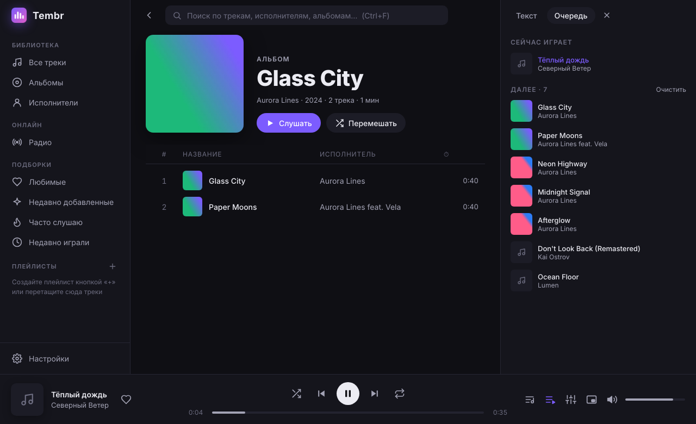
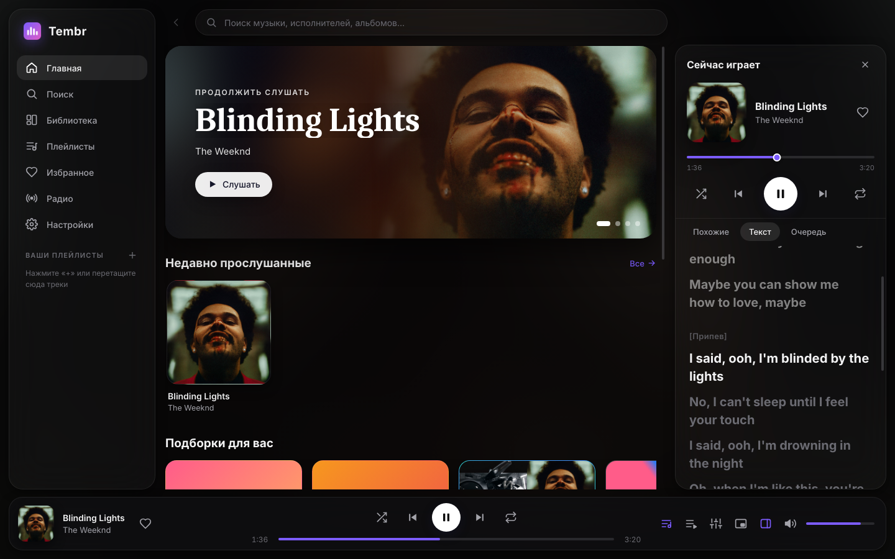

# Tembr

Музыкальный плеер для Windows.




## Скачать

**[⬇ Последняя версия (установщик для Windows)](https://github.com/kotik31bgd/Tembr/releases/latest)**: откройте ссылку и скачайте файл `Tembr-Setup-x.x.x.exe`.

После установки плеер обновляется сам: при запуске он проверяет новые версии, скачивает их в фоне и предлагает перезапуститься.

> Windows может показать предупреждение «Windows защитила ваш компьютер», потому что у программы нет платной цифровой подписи. Нажмите **«Подробнее» → «Выполнить в любом случае»**.

## Возможности

- Отслеживание папок с музыкой: новые файлы появляются в библиотеке автоматически
- Перетаскивание папок и файлов в окно, открытие аудиофайлов двойным кликом
- Обложки из тегов, из `cover.jpg` в папке или из интернета (MusicBrainz / Cover Art Archive)
- Тексты песен (LRCLIB) с подсветкой строк по ходу песни
- Альбомы, исполнители, плейлисты, «Любимые», «Часто слушаю», «Недавно добавленные», история
- Очередь с перетаскиванием, перемешивание, повтор
- 10-полосный эквалайзер с пресетами
- Интернет-радио (Radio Browser): поиск по жанрам и странам, избранное
- Audius встроен в поиск и главную: треки играют целиком, ♡ добавляет их в библиотеку, разрешённые исполнителем можно скачать
- Мини-плеер поверх окон, значок в трее, кнопки на панели задач, медиаклавиши
- Тёмная и светлая темы, выбор акцентного цвета

## Разработка

```bash
npm install
npm start          # запустить из исходников
npm run dist       # собрать установщик локально в папку dist/
```

Новая версия выходит так: поднять `version` в `package.json` и отправить коммит в `main`. GitHub Actions сам соберёт установщик и опубликует релиз `vX.Y.Z`, а установленные плееры подтянут его автоматически.
